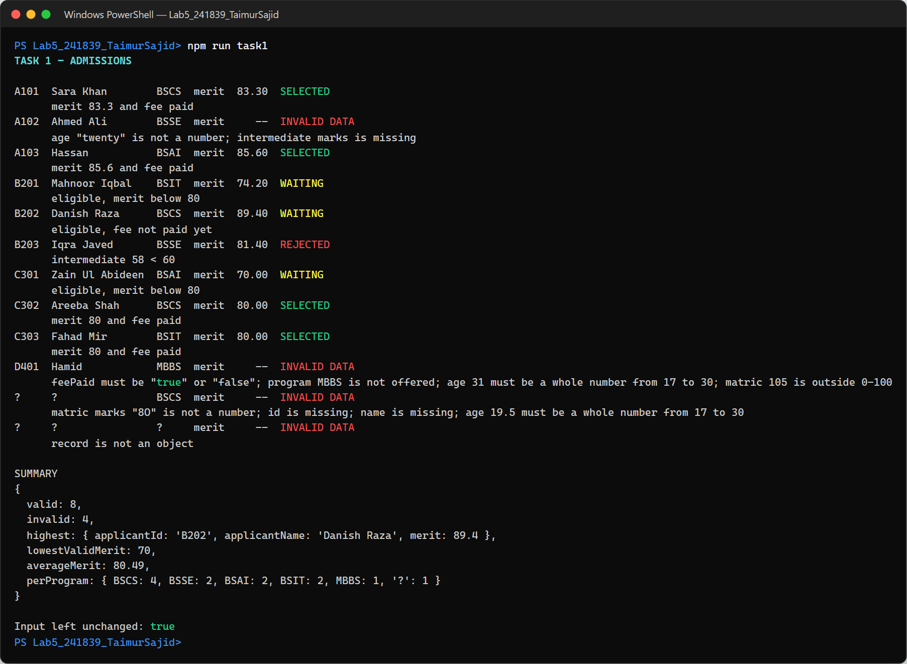
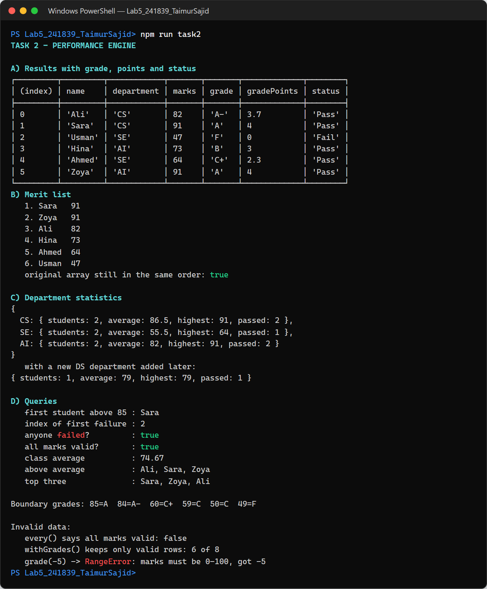
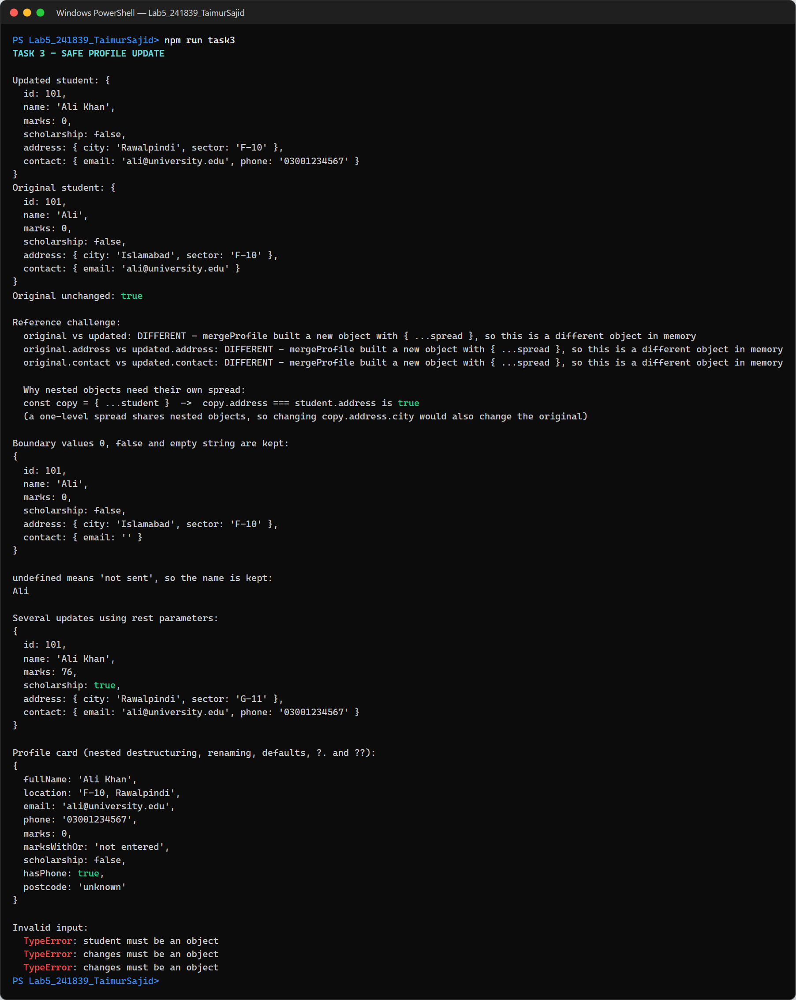
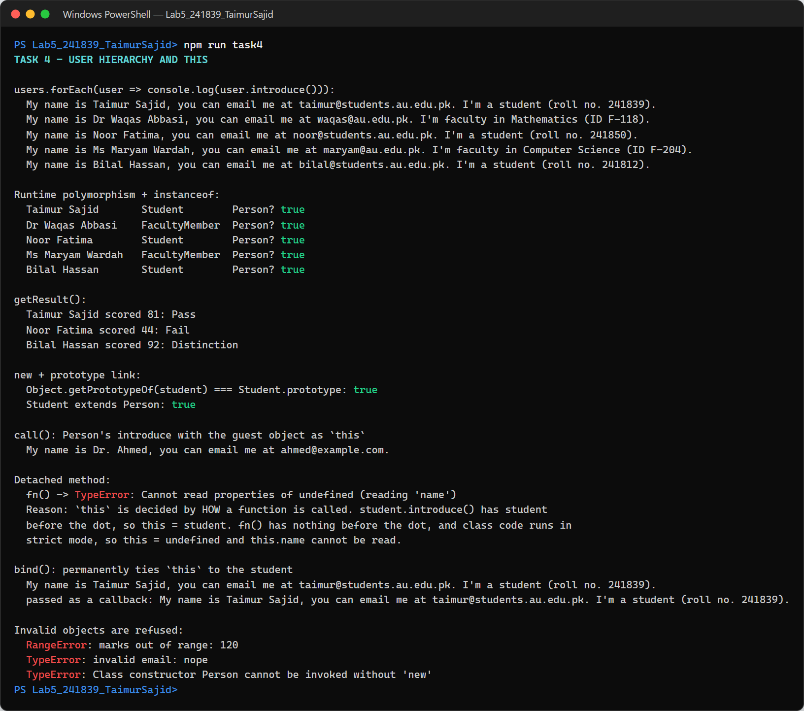
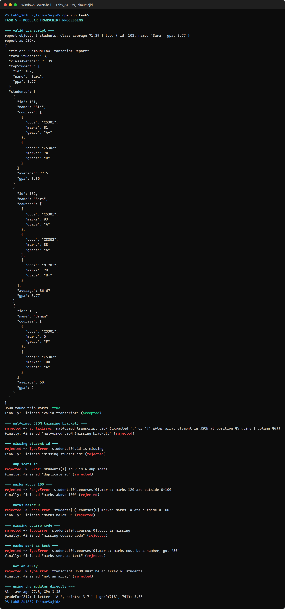
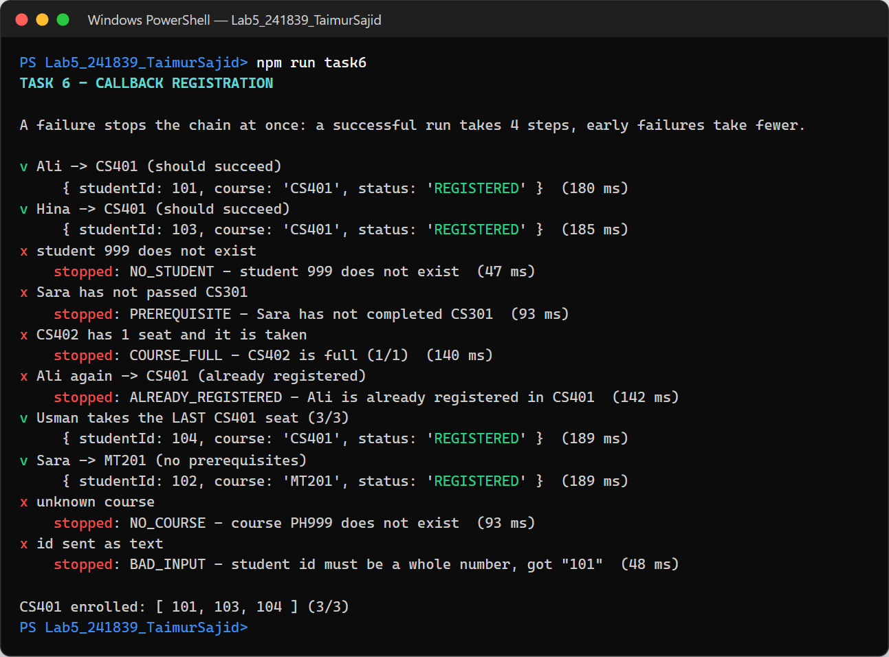
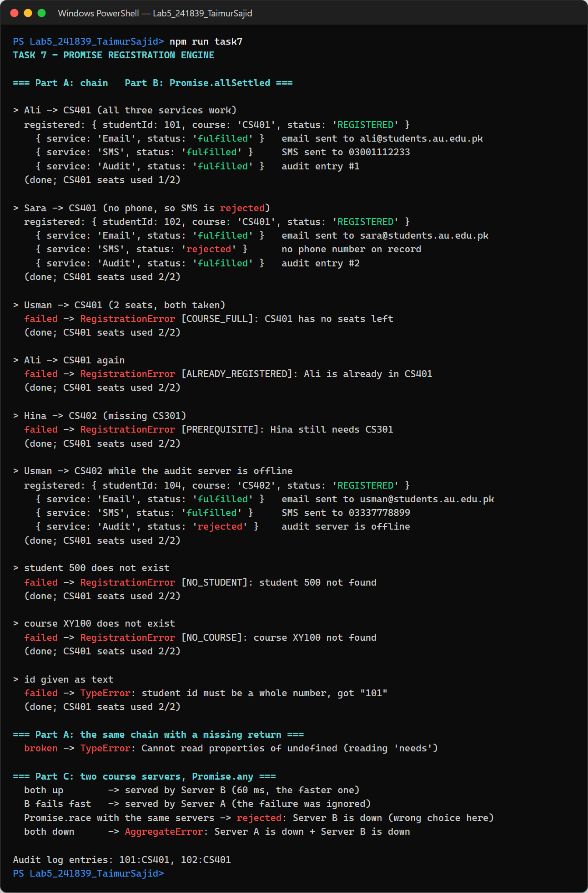
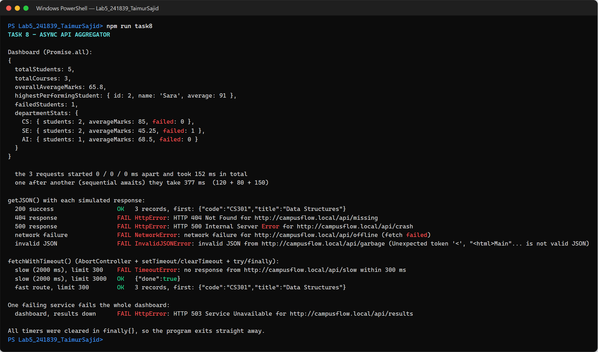
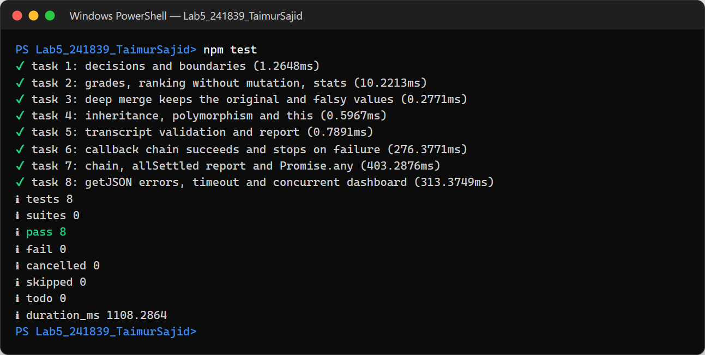

# Lab 5 – Advanced JavaScript (CampusFlow)

| | |
|---|---|
| **Name** | Taimur Sajid |
| **Roll No.** | 241839 |
| **Course** | Full Stack Web Development – Lab 5 |
| **Run with** | Node.js 18 or newer (no packages to install) |

CampusFlow is a university system. This lab builds its core logic in plain JavaScript (ES modules), one folder per task.

```
Lab5_241839_TaimurSajid/
├── task1/  admissions.js, run.js            Admission decisions + data cleaning
├── task2/  analytics.js, run.js             Result analytics with array methods
├── task3/  profile.js, run.js               Safe (immutable) profile updates
├── task4/  people.js, run.js                Classes, inheritance and `this`
├── task5/  main.js, Student.js,             Modules + fault-tolerant JSON
│           gradeUtils.js, transcriptService.js
├── task6/  registrar.js, run.js             Callback registration (error-first)
├── task7/  services.js, run.js              Promise chain, allSettled, any
├── task8/  aggregator.js, fakeFetch.js,     async/await API aggregator + timeout
│           run.js
├── test/   lab5.test.js                     Automated checks for all 8 tasks
└── screenshots/                             Terminal output of every task
```

## How to run

```bash
npm run task1      # ...up to task8
npm test           # runs the automated tests
```

Or without npm: `node task1/run.js`, `node task5/main.js`, and so on.

---

## Task 1 – Admission Decision and Data Sanitization Engine

Raw form data arrives as strings. Each applicant goes through **clean → validate → merit → decision**.

- `Number()` converts each value explicitly. Blank strings and `NaN` are reported separately. `"0"` and `0` count as real marks, so a falsy check is not used.
- `feePaid` is read by comparing text. `Boolean("false")` would give `true`.
- Merit = 20% matric + 30% intermediate + 50% entry test. To be eligible, an applicant needs merit ≥ 70, entry test ≥ 60 and intermediate ≥ 60.
- **SELECTED**: merit is 80 or more and the fee is paid. **WAITING**: eligible, but merit is below 80 or the fee is unpaid. **REJECTED**: not eligible. **INVALID DATA**: something is missing, not a number, out of range or not offered.
- Uses `switch` (program names), `if/else`, a ternary, a guard clause, `for` / `for...of` loops and `continue`.
- The summary shows valid/invalid counts, the highest and lowest merit, the average, and a count per program. The input array is never modified.



## Task 2 – Academic Performance Intelligence Engine

- **A:** `filter` + `map` add the grade, grade points and Pass/Fail to new objects.
- **B:** the merit list sorts a **copy** (`[...results].sort(...)`) by marks, then by name. The original order stays the same.
- **C:** `reduce` groups students by department. A new department such as DS works without changing the code.
- **D:** `find`, `findIndex`, `some`, `every`, `filter` and `slice`. These give the first student above 85, the first failure, the class average, the above-average students and the top three.



## Task 3 – Safe Student Profile Update Service

`mergeProfile(student, changes)` returns a **new** object:

- Spread creates a fresh `address` and `contact`, so nested objects are merged field by field and the original is never touched.
- `0`, `false` and `""` are applied. Only `undefined` means "not sent".
- Uses object/array destructuring, renaming, default values, rest/spread, property shorthand, optional chaining (`?.`) and nullish coalescing (`??`). The demo also shows `||` losing a mark of 0.
- **Reference challenge:** `===` compares references. `updated !== student` and `updated.address !== student.address` because spread built new objects. A one-level `{ ...student }` copy would still **share** `address`.



## Task 4 – University User Hierarchy and Dynamic `this`

`Person` is the parent class of `Student` and `FacultyMember`.

- Each class uses `constructor`, `super(...)`, and `super.introduce()` inside an overridden `introduce()`.
- `users.forEach(u => u.introduce())` runs the right version for each object (runtime polymorphism). `instanceof` checks each type.
- `call()` runs `Person`'s `introduce` with a plain guest object as `this`.
- **Detached method:** `const fn = student.introduce; fn()` fails. `this` depends on how a function is called: with nothing before the dot, and class code always running in strict mode, `this` is `undefined`.
- `bind(student)` fixes `this` permanently, so the method also works as a callback.



## Task 5 – Modular Transcript Processing and Fault-Tolerant JSON

| File | Exports |
|---|---|
| `Student.js` | **default** `class Student` (average, GPA, report row) |
| `gradeUtils.js` | **named** `calculateGrade`, `calculateAverage`, `calculateGPA`, `checkMarks` |
| `transcriptService.js` | **named** `parseTranscriptJSON`, `toStudents`, `buildReport`, `processTranscript` |
| `main.js` | the caller: default import, named imports, aliases (`calculateGrade as gradeFor`) |

The service parses JSON safely, then rejects the following. Each message gives the exact location, e.g. `students[0].courses[0].marks`.

| Problem | Error type |
|---|---|
| Malformed JSON | `SyntaxError` |
| Missing ID or name | `TypeError` |
| Duplicate ID | `Error` |
| Marks below 0 or above 100 | `RangeError` |
| Missing course code | `TypeError` |

It then calculates each student's average and GPA, builds a report object, and converts it back to JSON. `main.js` shows `try / catch / finally` for every input.



## Task 6 – Legacy Course Registration Using Callbacks

**Load Student → Check Prerequisites → Check Seats → Register Course**

- Each step uses `setTimeout` and the error-first `callback(error, value)` style, with no Promises or `async/await`.
- `callOnce()` guarantees that each callback runs exactly once.
- `later()` catches errors inside the timer and passes them to the callback. A `try/catch` cannot catch an error thrown in a different tick.
- Every level does `if (err) return done(err);`, so the first failure stops the chain. The timings in the output show this: failing at step 1 takes about 45 ms, and a full run takes about 185 ms.

**Why this style gets hard to maintain:**
- **Nesting:** every dependent step adds one more level of nesting (the "pyramid of doom"). Adding or reordering steps means moving whole blocks of code.
- **Repeated error checks:** the same check must be repeated at every level, and forgetting one lets the chain continue after an error.
- **try/catch doesn't work across async steps:** each step must forward its own errors.
- **No "exactly once" guarantee:** the language does not stop a callback from being called twice or never.



## Task 7 – Promise-Based Multi-Service Registration Engine

- **Part A – chain:** `getStudent → getCourse → checkPrerequisites → checkSeats → registerStudent`.
  - Every `.then()` **returns** the next promise, so data moves to the next stage.
  - One `.catch()` handles a failure at any stage, and `.finally()` always runs.
  - `chainWithMissingReturn()` shows the bug: without `return`, the next stage receives `undefined`.
- **Part B – `Promise.allSettled`:** email, SMS and the audit log are independent, and we need the status of **all three**, even if one fails. `Promise.all` would stop at the first rejection.
- **Part C – `Promise.any`:** accepts the first server that **succeeds** and ignores fast failures. It only rejects with an `AggregateError` if every server fails. `Promise.race` was not used because it settles with whichever finishes first, even a failure. The demo shows race rejecting while a working server was still on its way.



## Task 8 – Concurrent Academic API Aggregator (async/await)

- `getJSON(url, fetchImplementation)` calls fetch, checks `response.ok`, parses the JSON, and throws a different error class for each kind of failure:

  | Failure | Error class |
  |---|---|
  | Bad HTTP status | `HttpError` |
  | Network failure | `NetworkError` |
  | Body is not valid JSON | `InvalidJSONError` |
  | Request too slow | `TimeoutError` |

- `fakeFetch` returns response-shaped objects, like the real Fetch API. It can simulate 200, 404, 500, a network failure, invalid JSON and a slow response.
- The dashboard starts `/users`, `/courses` and `/results` **at the same time** with `Promise.all`. The output shows 150 ms, against about 370 ms with sequential awaits.
- From the data it builds the totals, overall average, top student, number of failed students and per-department statistics.
- `fetchWithTimeout(url, ms)` uses `AbortController` + `setTimeout`. `clearTimeout` runs in `finally`, so the timer is cleaned up on success and on failure.



## Automated tests


